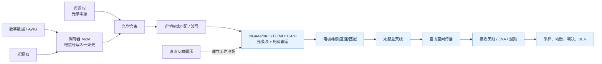
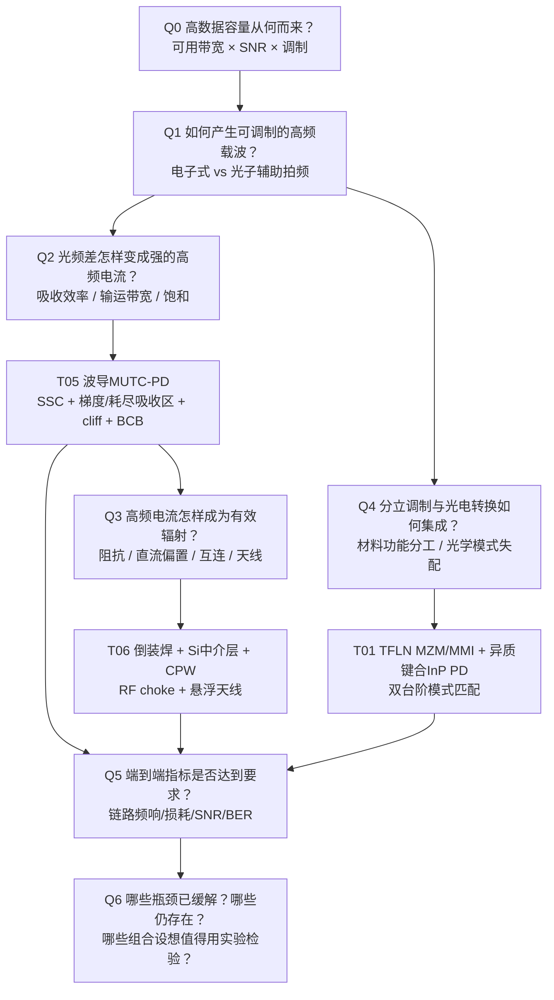
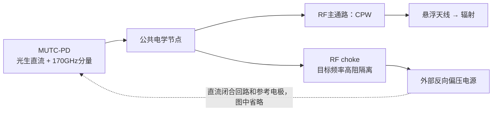

# 光子辅助太赫兹发射：问题推演、原文证据与可检验研究设想

建立：2026-11-16｜版本：v1.0（**研究问题体系冻结版，尚非汇报讲稿或PPT**）  
所属专项：[陈佰乐课题组工作区](README.md)｜上游：[调研任务书](2026-11-12-research-brief.md) · [学习路线](2026-11-12-problem-driven-learning-roadmap.md)

> **根命题：** 怎样在有限光功率、反向偏压、尺寸、加工精度、带宽和链路损耗约束下，让数字信息经过光学调制 → 光电拍频转换 → 高频电磁传输/辐射 → 无线接收，获得可验证的高速太赫兹通信能力？
>
> **研究原则：先提出物理或系统约束，再解释为何出现相应结构；以原始图像和实测/仿真证据检验，最后明确未解决的限制和下一步可检验问题。** 不以器件名称或论文发表顺序倒推技术意义。

## 0. 定位、来源、结论层级

### 0.1 使用场景与边界

- 面向刘癸庚老师与上海科技大学陈佰乐团队相关技术交流的首次学术技术调研；**讨论器件物理、技术链路及技术可行性，不代替导师做商业、合作、采购或系统路线决策**。
- 核心原文均已由用户提供PDF并于2026-11-16阅读核对；此文件**只记录原创研究分析和原图索引**，不在Git仓库中再分发论文PDF或受版权保护的原图。
- 本文是长效知识资产，优先保留因果推导、物理图像、证据口径与可检验假设；之后再从本文提取**讲述顺序、讲稿、PPT和答疑清单**。
- 技术逻辑排列T05 → T06 → T01，**不等于历史时间序列、同一芯片的三代版本，也不意味着后一个实验继承了前一个实验的所有指标**。

### 0.2 三篇主要原始文献

| 内部编号 | 论文、来源 | 在论证中的角色 |
|---|---|---|
| T05 | Li et al., *Modified uni-travelling-carrier photodiodes with 206 GHz bandwidth and 0.81 A W−1 external responsivity*, *Nature Photonics* 19, 1301–1308 (2025). [DOI](https://doi.org/10.1038/s41566-025-01784-0) | 光输入、吸收、MUTC载流子输运、寄生电容、波导模块与无线链路 |
| T06 | Lu et al., *Hybrid Silicon-Interposer Platform With Integrated Suspended Antenna for Compact Photonic Terahertz Communications*, *J. Lightwave Technology* 43(19), 9368–9374 (2025). [DOI](https://doi.org/10.1109/JLT.2025.3600999) | PD电极—CPW—偏置网络—天线的紧凑射频集成 |
| T01 | Wang et al., *Heterogeneously integrated photonic terahertz transmitter on thin-film lithium niobate*, *Nature Communications* 17, 9797 (2026). [DOI](https://doi.org/10.1038/s41467-026-76733-8) | TFLN电光调制、片上合束、异质键合InP UTC-PD与光学模式转换 |

**证据层级标记：** 【实测】实验结果；【仿真】作者模拟、计算或模型拟合；【解释】作者基于多种证据提出的物理机理；【推演】本调研的条件性推论或新设想；【待核】尚需要补充材料/控制实验的内容。不得互相替代。

## 1. 先建立唯一的完整物理场景

### 1.1 信息、能量与反馈不是同一个东西

以**光子辅助发射＋电子式接收**作为通用示例；它不是刘老师已定型的技术路线，也不是三篇论文共同制造的单片系统。

**三条必须同时跟踪的链：**

1. **信息链：** 数据被编码到光场振幅/相位 → 在光电拍频后转移到高频电流 → 天线辐射 → 接收端恢复。光学频差是**载频**，数据是载频上携带的包络或其他调制参数。
2. **能量链：** 光纤端光功率 → 片内耦合/吸收 → 可用高频电流与电学功率 → 射频负载实际接收功率 → 天线辐射功率 → 空间路径损耗 → 接收功率。每个界面都有可能损失。
3. **物理反馈链：** 高光功率提高光生载流子密度 → 非均匀空间电荷和结电压变化可能重分配内部场 → 输运与高频饱和发生改变；温度、匹配、噪声也会反馈影响结果。**生成电子—空穴对更多不等于局部自动出现同等净空间电荷**；必须考虑两种载流子分离和分布。

### 1.2 必须坚持的数量区分

- 香农容量模型 $C=B\log_2(1+\mathrm{SNR})$：提高**载频**本身不直接提高数据率；高频段的机会是更宽的**可用频谱**，且仍受SNR限制。
- 两束相干光满足合适偏振/相位关系时，光功率具有差频项：$P(t)=P_1+P_2+2\sqrt{P_1P_2}\cos[2\pi(f_1-f_2)t+\phi]$。光电二极管响应差频，不需要电子追随约193 THz的光学振荡。
- **器件电学3 dB带宽、太赫兹载波频率、数据调制带宽、符号率、线路比特率、纠错后净吞吐量互不等同**。
- 响应度必须注明**光纤端/芯片端/片内**口径；功率必须注明**芯片电学端口/封装波导端口/天线辐射/接收端**；距离必须结合调制、误码、功率、增益及设备条件。
- 对两种不同实验条件的标称峰值，不做“减去几个dB就得到集成损耗”的无条件推算。

## 2. 主问题树：从需求到器件，再回到系统

**拓扑说明：** Q3和Q4是同一发射链的不同端口问题，研究可并行进行。讲述上先从“光电流怎么生成”进入“电流怎么辐射”，再回到“输入侧怎么集成”，是为了维持听众的物理直觉，而不是伪造论文依赖关系。

### Q0→Q1：通信需求为什么推动高频信号产生路线？

- **问题起点：** 提升无线吞吐量需要可用带宽、频谱效率、链路SNR与足够低的失真；亚太赫兹频段提供宽带频谱机会，同时提高发射、接收和传播难度。
- **路线选择：** 电子式振荡/倍频/混频能够产生高频信号，但高频器件及谐波转换性能受约束；光子辅助用两光频差形成目标频率拍频，改变了生成载频的物理路径。
- **新问题：** 光学拍频的存在，不等于PD有足够的高频电流，不等于天线有足够的辐射功率，也不等于高数据率。

### Q1→Q2：为什么研究UTC/MUTC而不是只提高输入光功率？

- 需要较强**直流响应度**（更多输入光有效生成/收集电荷）、足够高**高频响应**（跟随光强快速变化）和足够大**饱和射频功率**（在强输入下仍维持高频调制深度）。
- PIN的光生电子/空穴均可在耗尽吸收区参与漂移，高速限制之一是空穴路径；UTC令大部分空穴在p型吸收区局部响应，电子作为主要跨越收集区的输运载流子；MUTC在部分吸收区引入耗尽及电场设计，缩短电子扩散而不无限增加空穴漂移。
- 低光功率带宽好不代表大光功率下输出强；局部空间电荷、界面障碍、有效偏压变化、速度场依赖以及发热均可能参与饱和。
- 由此进入T05。

## 3. T05：高速光电转换的连续物理图像

### 3.1 从“光在哪里走”推导波导优势，而不是背诵波导比垂直入射好

**初始矛盾：** 垂直吸收层厚度增加通常提高吸收机会，却可能增加载流子收集方向的路径/时间。波导型PD让主要光传播方向（记作z）与主要载流子收集方向（外延厚度方向y）近似正交。

**最关键的纠偏：** 不是“光在下方无吸收波导里多走一段，就自然增强吸收”。实际导波模式的电场**与InGaAs吸收层有非零横向空间重叠**；每经过一段z，就可在吸收层中产生新光生载流子。延长有源波导，使这种重叠吸收在更长的z范围发生，电子仍主要沿局部y方向输运。

对横截面固定、有效模态吸收系数近似常数的简化模型：
- $dP/dz=-\alpha_{\mathrm{eff}}P$，$P(z)=P(0)e^{-\alpha_{\mathrm{eff}}z}$。
- $\eta_{\mathrm{abs}}\approx1-e^{-\alpha_{\mathrm{eff}}L}$（**仅在其他损耗忽略时**）。
- $\alpha_{\mathrm{eff}}$由材料吸收、光学模式重叠及导波条件决定。SSC过渡段模式仍在改变时，$\alpha_{\mathrm{eff}}$可随z变化。
- 长L提高吸收会趋于饱和，而器件面积/电容可能继续增大，故**波导把两条长度尺度部分解耦，不是消除所有权衡**。

### 3.2 两段式SSC → 光到吸收层的真实路径

- **第一级：** 稀释InGaAsP/InP光波导与光纤模式匹配，降低光纤至片上的耦合损耗。
- **第二级：** 两层InGaAsP模式匹配层使光场沿z逐步向上方InGaAs吸收区转移；它调整的是折射率分布与光学模式，不是给电子加速。
- **原图：** T05 Fig. 1a（器件结构）、1c（外延截面）、1g（沿z与高度的光学强度模拟）。看1g时必须把横轴z和高度方向区别开；亮度分布迁移≠几何光线在爬坡。

### 3.3 光子→电子空穴对→垂直收集

- 电子在上方未耗尽的p型InGaAs吸收区中需扩散，也受到梯度掺杂形成的准电场辅助；进入耗尽吸收区后受电场漂移；经InGaAsP异质结过渡层到InP收集区。
- 空穴在未耗尽p型吸收区域主要以多数载流子的局部电荷弛豫响应；在耗尽吸收区中产生的空穴仍需向p侧漂移。因而**扩大耗尽吸收层起初改善电子输运，过大时空穴贡献反过来限制带宽**。
- T05选用总厚165 nm的部分耗尽InGaAs吸收层，其中未耗尽65 nm、耗尽100 nm。Fig. 1e是耗尽厚度与**模型输运限制带宽**的关系，100 nm设计对应约416 GHz计算带宽；**不是完整器件实测416 GHz**。
- InGaAsP过渡层缓解异质结输运障碍；n型InP cliff层通过固定掺杂电荷调节电场分布，降低电子在界面滞留/高注入屏蔽风险。Fig. 1d是不同光电流下电场分布**仿真**，不能当作电子速度的直接实测。
- 注意三个容易混淆的“梯度”：**SSC材料/几何梯度作用于光学模式；p型吸收区掺杂梯度作用于电子扩散和内建准电场；异质结grading作用于能带过渡**。

### 3.4 载流子快还不够：RC及高频电学端口

- 光生载流子的运动通过电极诱导电流响应，**不必等全部电子到达电极后电流才开始变化**。
- 结电容、CPW金属电极的寄生电容/电感/电阻及外部负载决定最终频率响应。低介电常数BCB用于减少电极下的寄生电容；T05 Fig. 1h–i给出相关模拟。
- 【实测】T05 Fig. 2：7/10/15 μm有源长度下，外部响应度分别约0.29/0.53/0.81 A/W（Fig. 2b，在对应响应度测试条件下）；相应3 dB带宽278/243/206 GHz（Fig. 2d–f，**偏压和光电流测试口径与2b不同**）。
- 【解释】更长有源区提高累计吸收，但结电容增大，频率响应降低；短器件速度更快，不代表高功率输出一定最强。
- 【实测】Fig. 2g–h展示180 GHz输出随电流的饱和和220 GHz偏压相关行为；改变电场并非必然单调提升输出。热、空间电荷及速度动态等可能共同作用；**不要把射频输出曲线当作电场直接测量**。
- 【实测】Fig. 3：WR-5.1封装模块在8.5 mA时127–185 GHz端口功率高于−5 dBm；54 m、150 GHz、最高120 Gbit/s为特定调制/BER与通信设备条件下的**线路速率演示**，并非无条件净吞吐量。封装模块响应度另有口径，不能替换芯片0.81 A/W。

**T05回答程度：** 从“光纤耦合→波导吸收→MUTC输运→电极高频响应→矩形波导模块”形成有实测支撑的器件/模块链。仍未消除吸收长度/电容、频率/高功率、封装接口与通信设备约束。

## 4. T06：已产生的高频电流如何真的变成空间辐射？

### 4.1 第一处瓶颈：从PD电极到天线馈电

- 高频下PD并非理想电流源，电极、金凸点、CPW、馈线都有分布参数；失配引起反射/端口电流电压重分配，导体与介质还会产生损耗。
- T06采用波导型MUTC-PD，通过**金凸点倒装焊**与硅中介层CPW连接，并协同优化几何尺寸/约50Ω阻抗。这解决的是**电学互连接口**，不等于T05/T01的光学SSC。
- 必须分开：**阻抗匹配**决定电源向天线交付多少功率；**辐射效率**决定天线接收功率中有多少形成辐射；**方向图/增益**决定辐射能量空间分配。匹配好不保证天线辐射效率高。

### 4.2 第二处瓶颈：MUTC-PD需要直流偏压，射频不能漏到偏压支路

- 反向偏压提供/调节耗尽区和内部电场、影响载流子输运与饱和；170 GHz本身来自光学差频，**不是直流电源产生的**。
- 直流偏压支路不能任由170 GHz信号泄漏。论文设计两对CSRR（互补开口谐振环）形成频率选择RF choke，用偏置三通（bias-T）把DC和RF的功能分开。
- 【仿真】T06 Fig. 1（原文三端口曲线）：162–194 GHz内主通路$S_{21}>-3$ dB，偏置支路隔离$S_{31}<-10$ dB；**并非绝对无损/绝对隔离**。看图必须以端口标识为准。

### 4.3 第三处瓶颈：信号到了天线却被硅衬底影响

- 金属天线附近有高介电常数硅基底，可能引入衬底模式、表面波、背向辐射及材料损耗。
- T06局部移除硅，在约300 nm SiNₓ薄膜上支撑天线，下面设置金属反射结构：通过改变电磁边界条件与辐射环境改善方向性及有用辐射。
- 【仿真】天线$S_{11}<-10$ dB约160–194 GHz；实现增益7.22 dBi来自**仿真**，不是独立实测增益。
- 新工艺问题：薄膜残余应力、机械稳定性、芯片安装/金凸点几何偏差及热耗散。不能把“膜薄”自动等同“辐射效果好”。
- 【实测】T06 Fig. 3为倒装焊前后I–V和接收功率；Fig. 4为170 GHz OOK、最高12 Gbaud（对应12 Gbit/s原始线路速率）、BER和均衡前后眼图。CMA均衡改善可补偿失真，但**不能凭空增加接收信号功率或消除所有噪声**。论文BER基于未实施实际FEC纠错的采样数据，对照FEC门限做可纠错性判断。

**T06回答程度：** 在具体频带验证PD→CPW/偏置→紧凑天线的混合集成发射前端与通信可行性；**仍需片外激光、调制器、EDFA和接收设备**，天线辐射性能证据中仿真与实测要分开。其射频工作范围不能自动拓展到T01的所有测试载频。

## 5. T01：上游光学调制与InP光电转换为何需要异质集成？

### 5.1 分立系统为什么仍然复杂？

- T06即使已经整合PD与天线，光源、MZM、合束与光纤/EDFA仍在片外。各光学接口带来体积、对准、损耗和稳定性问题。
- T01选择TFLN承担低损耗高速电光调制，III-V InGaAs/InP承担快速光吸收与UTC输运；**材料功能分工优于强迫同一种材料在所有子任务都最优**。
- 集成范围：TFLN片上MZM + MMI合束 + BCB键合InP UTC-PD；双激光器、EDFA、天线探针、接收机与DSP仍在片外。Fig. 1a是含潜在应用场景的**概念架构图**，Fig. 1c是实际芯片照片，不能当成整套系统的实物图。

### 5.2 难点不是“粘到一起”，而是光学场怎样跨材料进入吸收层

- TFLN波导导模和InGaAs高折射率吸收区导模不匹配，直接耦合需要较长长度；过长有源区会增加电容，不利高带宽。
- T01通过在InP收集/接触区域蚀刻**双台阶**，调节有效折射率与局部模态耦合，让光沿z逐步从下方LN波导向上方InGaAs吸收区转移；不是光子受力爬坡。
- 【仿真】T01 Fig. 2f–i给出双台阶/单台阶/无台阶的光场分布与各截面；2j给出7 μm有源长度下双台阶约56.46%模拟吸收量子效率，对照单台阶约26.07%、无匹配约20.34%。这些属于**模拟，不是三只实际器件的对照实测**。
- 【实测】Fig. 2a–b证明相应结构的制造形貌；Fig. 3d为片上PD响应度的测量。前者不直接验证每个位置的实际光场分布，后者不能单独把改善全部归因于双台阶。
- **SSC缩写警告：** T05的SSC为Spot-Size Converter（光斑尺寸转换器）；T01讨论光调制架构时的SSC为Single-Subcarrier Modulation（单子载波调制），不可混用。

### 5.3 集成后如何保持电荷输运和调制线性？

- T01采用约180 nm的部分耗尽InGaAs吸收区、30 nm n型InP cliff层和220 nm InP收集层等外延设计；继续面临扩散/漂移、空间电荷与电场分布的权衡。
- 只调制一束光、另一束作为光学本振，拍频幅度$\propto A_1(t)A_2$；与两束光同时被调制相比，可降低多电平PAM4对应的乘积非线性风险。需要区分调制器电光带宽与PD电学带宽。
- 【实测】T01 Fig. 3a：2×7 μm²集成PD在1 mA光电流下测得240 GHz电学3 dB带宽；Fig. 3d：1550 nm附近内部响应度约0.67 A/W，外部约0.21 A/W；Fig. 3e：TFLN MZM电光响应带宽>67 GHz。
- 约5 dB**光纤→TFLN芯片**输入耦合损耗造成外/内部响应度差异，近似$R_\mathrm{ext}\approx R_\mathrm{int}10^{-5/10}$。这不同于TFLN→III-V双台阶接口，说明解决片内耦合并不等于解决片外输入损耗。
- 【实测】Fig. 3b在150/180/210 GHz测量射频输出随电流增长及高频下降；这些频点的输出功率不能由3 dB带宽单独推导。

### 5.4 如何判断这只芯片实现了通信，而非“只有好看的器件指标”？

- 【实测】T01 Fig. 4：150 GHz下40 Gbit/s、200 GHz下32 Gbit/s，0.2 m链路，NRZ/PAM4，BER与眼图。线路速率不是扣除FEC后的净吞吐率。
- 实验仍使用片外两激光器、EDFA、探针接天线、LNA、下变频器、示波器与离线DSP；链路在150/200 GHz自由空间损耗论文分别给出约62/64.5 dB。
- **最重要的作者自述限制：** 端到端实际速率受调制驱动、探针→天线耦合、混频/本振倍频、频响起伏和SNR共同限制，**尚未充分释放>67 GHz调制器与240 GHz PD的潜力**（论文Discussion/系统分析）。这是理解“器件性能≠系统性能”的原始证据。

**T01回答程度：** 验证TFLN调制+MMI+InP光电拍频的**片上光学功能集成**，同时保留很高器件带宽；并非已实现集成光源、集成天线和完整收发机。还留下约5 dB的片外耦合损耗及RF端到端链路限制。

## 6. 证据矩阵：三篇论文分别做到什么、哪些仍不能声称解决

| 技术环节 | T05 | T06 | T01 | 未解决/边界 |
|---|---|---|---|---|
| 光纤到芯片 | 两段SSC，实测较高外响应度 | 片外光纤接入PD | 约5 dB光纤→TFLN损耗 | 输入耦合/封装稳定性和效率 |
| 光学模式进入吸收层 | 稀释波导+InGaAsP匹配 | 复用波导型PD | III-V双台阶匹配，光场/吸收**仿真** | 工艺公差、吸收均匀性、输入/片内共同效率 |
| 电荷输运 | 165 nm部分耗尽吸收层、电场/RC优化 | 复用外部MUTC-PD | 180 nm部分耗尽吸收层、cliff、集成后实测 | 高注入空间电荷/热、300 GHz射频功率 |
| 带宽与响应度 | 15 μm：206 GHz、外0.81 A/W | 非独立最新带宽纪录 | 7 μm：240 GHz、内0.67 A/W，外0.21 A/W | **口径与条件不同，不可直接排名** |
| 射频接口 | WR-5.1封装，波导端口实测 | 倒装焊+CPW+偏置三通，S参数仿真 | GSG探针/外接天线 | 模块尺寸、带宽、损耗、集成相容性 |
| 天线 | 外接天线用于通信 | 悬浮天线，7.22 dBi**仿真** | 探针接天线 | 集成天线实测、宽频匹配和辐射效率 |
| 系统验证 | 54 m、150 GHz、最高120 Gbit/s | 170 GHz、最高12 Gbit/s OOK | 0.2 m、150/200 GHz、40/32 Gbit/s | 不同调制/距离/设备，无法拼装指标 |
| 光源/接收机 | 仍有外设 | 仍有外设 | 仍有外设 | 光源/本振、接收、能耗、长期稳定性 |

**已缓解 ≠ 已彻底解决。** 三个研究分别验证器件光电转换、射频天线接口、光学异质集成的一部分可行性；没有一篇独立证明高频大功率、低输入损耗、全天线集成、完整片上收发及长距离高净速率同时成立。

### 瓶颈迁移不是口号，而是一条可以被数据检验的链

**重要：** 这只是按系统问题组织的解释图，并非T05、T06、T01属于同一产品的顺序升级，也不是每篇论文已经证明前一环的限制完全消失。

## 7. 从已有成果主动提出具体、可证伪的新研究问题

研究设想必须满足五项：**明确起因、设计变量、可观测指标、控制组/条件、成立或失败的判断标准**。以下全部标记【推演】，不是三篇论文已实现的结果。

### H1【优先】：T01的TFLN/InP发射芯片能否与T06的低损耗天线输出结构协同设计？

- **事实起点：** T01已片上集成调制与UTC-PD，但仍探针连接外接天线；T06已演示PD→CPW/偏置→悬浮天线的紧凑集成，但光调制位于片外。
- **具体问题：** 能否围绕**170 GHz**作为第一验证频点，重新设计TFLN/InP PD电学输出端、RF choke、CPW到天线馈电的连续阻抗，使片内光子功能和紧凑辐射功能在同一发射前端工作？
- **为什么选170 GHz：** 位于T06约160–194 GHz的模拟匹配范围及T01器件已测试的频率能力范围；150/200 GHz目标仍需重新做天线/网络设计。不是声称两套现成结构可直接粘合。
- **控制与方法：** 同一类TFLN/InP芯片，比较探针外接天线和新设计的联合输出模块；固定光功率、两光频差、偏压、光电流及测量校准；联用全波电磁仿真、片上S参数与远场/接收功率测量。
- **关键观测：** 馈电$S_{11}/S_{21}$、实际可辐射功率或EIRP、有效带宽、相同调制下的BER/眼图、热与装配重复性。
- **可能失败原因：** 基底/薄膜材料不相容、BCB与金凸点结构难以兼容、偏压隔离恶化、加工公差使天线失谐、器件发热和馈电损失抵消集成收益。
- **科学价值：** 检验“光学集成＋射频集成”是否真正减小端到端损耗，不以缩小面积代替系统改进。

### H2【高优先】：T01已测得的约5 dB光纤—TFLN输入耦合损耗能否显著降低？

- **事实起点：** T01内部0.67 A/W、外部0.21 A/W；双台阶解决的是TFLN→III-V的**片内模式耦合**，并未消除光纤→TFLN输入损耗。
- **具体方案候选：** 面向TFLN波导的渐变模式扩展器、反锥形taper、边缘耦合或封装对准结构；借鉴T05“模式空间分布渐变”思想，**不直接搬用InGaAsP材料层**。
- **可计算假设：** 如果只把光纤输入损耗由5 dB降到2 dB且保持片内性能不变，则外部响应度估算$0.67\times10^{-2/10}\approx0.42$ A/W，约为原0.21 A/W两倍；这是**条件性预测，不是实验成果**。
- **控制与指标：** 相同光源波长、偏振、芯片有源区与光功率定义；比较端面耦合损耗、外部响应度、偏振敏感性、对准容差、温漂、工艺良率。
- **可能失败原因：** 模式扩展器增加芯片占地/散射、偏振依赖增强、封装重复性变差；输入改善不一定提升本征PD带宽。

### H3【深入物理】：光学吸收的三维空间分布与MUTC电场能否联合优化以提升高频饱和功率？

- **事实起点：** 光子被吸收的位置决定$G(x,y,z)$光生载流子产生率；载流子分离/积累与掺杂分布共同决定$\rho(x,y,z)$及内部电场。相同总吸收量未必等于相同局部电流密度和热分布。
- **条件性假设：** 在保持总体光吸收/平均光电流及器件主要面积相近时，调整光学耦合和纵向吸收分布，可能改变载流子积累热点与局部电场屏蔽，提高某频点射频压缩门限。
- **方法路径：** 光学FDTD/模态分析得到三维$G$ → 半导体漂移扩散/能量平衡与泊松自洽求解 → 高频响应/大信号模型 → 制造至少一组**总吸收相近、空间分布不同**的对照器件。
- **关键观测：** 固定光电流时的RF输出压缩、偏压敏感性、电场/载流子密度/温度分布模拟、频率响应及结电容。
- **必须承认的反例：** 如果电场扰动主要受纵向收集方向的电荷分离而不受z向吸收重分布影响，这项调整可能几乎无效；若改变光模式同时增加面积/电容，也可能使性能更差。不可预先宣称吸收均匀必然优化饱和。

### H4【备用，不必作为首次汇报重点】：片上双光频源或相关锁定怎样降低漂移和片外依赖？

- **事实起点：** 发射频率取两激光光频差；两个独立光源的相对频率/相位漂移、偏振变化、外部EDFA和光纤装配会影响系统稳定性。
- **具体方向：** 双波长片上光源、光频梳、注入锁定/相位相关双光频，与TFLN调制及InP UTC-PD结合。
- **评估指标：** 差频相位噪声、频率漂移、调制EVM/BER、光输出功率与放大需求、总功耗、热调谐和制造复杂度。
- **边界：** 该方向在T01讨论中已有展望，不是本组已完成片上双激光源和独立完整发射机；需要新的源端论文与实验验证。

### 四项问题的优先关系

- 首次汇报中优先提出 **H1（可组合的架构与新接口）＋H2（有定量损耗依据）＋H3（具体多物理耦合假设）**，H4留作追问。
- H1并不是一定要做成“完整单片收发机”；外接光源、封装模块和混合接收机都可以是有效方案，取决于后续系统目标。
- 这些设想是研究性讨论，**不是合作价值判断或要求导师采纳的技术路线**。

## 8. 汇报前必须守住的原文证据与答疑边界

### 8.1 原始图像索引（PPT阶段优先用原图＋独立简化物理模型）

| 论文 | 首选原图 | 想让听众看到什么 | 必须讲清的证据级别 |
|---|---|---|---|
| T05 | Fig. 1a,c,g | 光纤→SSC→光场上移到吸收层，外延厚度与传播方向不同 | 结构/SEM与光场**仿真** |
| T05 | Fig. 1d,e,h–i | 电场工程、耗尽厚度与输运带宽、BCB寄生优化 | **模型和仿真**，416 GHz非实测 |
| T05 | Fig. 2b,d–h | 响应度随波导长度增加、带宽减少、饱和/偏压变化 | **实测**，不同子图条件可能不同 |
| T05 | Fig. 3a–e | WR-5.1模块、端口功率、54 m通信及BER | **模块/链路实测** |
| T06 | Fig. 1a–g | 硅中介层/倒装焊、偏置隔离、悬浮天线 | 照片/几何＋S参数/天线**仿真** |
| T06 | Fig. 3a–d | 实物测试连接、倒装焊前后I–V及接收功率 | **实测** |
| T06 | Fig. 4a,d–f | 170 GHz OOK从调制到下变频、BER与眼图 | **通信实测＋离线均衡** |
| T01 | Fig. 1a–c | 概念架构、材料截面、实际芯片 | 区分**概念图**和**实物照** |
| T01 | Fig. 2a–j | 双台阶、SEM、能带/场、三种耦合对照 | 结构照片＋场/效率**仿真** |
| T01 | Fig. 3a–e | 240 GHz、射频输出、响应度、MZM电光频响 | **实测**，内/外口径不可互换 |
| T01 | Fig. 4a–d | 片内外边界、BER和NRZ/PAM4眼图 | **通信实测**，0.2 m与独立外设 |

后续制作PPT时需按许可保留原图出处与图号；简化模型单独绘制并显著标记“概念图/重新绘制”。不把同一论文里的模型仿真图片称为实际电场或光场测量。

### 8.2 高风险误读与建议回答

| 可能被问 | 严谨回答 |
|---|---|
| 为什么波导越长越容易吸收？ | 进入有源区后导模电场沿整个z向有源长度与InGaAs层重叠，不是光在纯无损波导里待久了；累计模态吸收近似$1-e^{-\alpha_{eff}L}$，但电容也可能增加。 |
| 电子是不是必须抵达电极才有高频电流？ | 否，运动电荷会诱导电极电流；有限输运时间与电路寄生共同决定调制传递。 |
| 为什么T05模型416 GHz而实测206 GHz？ | 前者只讨论输运限制的模型带宽，后者是实际结构在特定偏压/光电流等条件下的高频响应，包含RC与接口寄生。 |
| 为什么T06还要直流偏压支路？ | 偏压维持PD的耗尽区与内部电场；170 GHz来自光拍频；RF choke帮助目标频率信号主要前往天线，而非泄漏至电源。 |
| T06仿真7.22 dBi等于天线实测7.22 dBi吗？ | 不等于。独立增益实测与整体接收功率验证不是一个概念。 |
| T01为何有0.67与0.21 A/W两个响应度？ | 0.67是修正约5 dB光纤→片上输入耦合损失后的内部口径，0.21是外部口径。 |
| T01的240 GHz带宽是否意味着240 Gbit/s？ | 不意味着。器件频响、调制频谱、接收链路SNR/非线性和纠错开销均另行约束。 |
| 三篇工作是否可直接拼成一套系统？ | 不可以。不同基底、工作频带、接口、器件尺寸和测试条件；H1仅是需重新设计并实测的假设。 |
| 调制链的SSC和光学耦合SSC是同一个东西吗？ | 不是。T01 Single-Subcarrier Modulation；T05 Spot-Size Converter。 |

### 8.3 团队归属与系统边界

- T05的核心MUTC外延/器件与模块研究主要体现上海科技大学团队能力；54 m通信实验是多团队合作结果，勿把整个系统实验称作单一课题组独立完成。
- T06涉及浙江大学、上海科技大学等团队：上海科技大学提供波导型MUTC-PD，硅中介层/天线与通信系统为多方研究，按原文作者贡献和工作分工介绍。
- T01论文作者贡献声明：陈佰乐提出研究设想并参与UTC-PD设计；TFLN器件设计涉及香港城市大学团队；通信实验及其他任务由多方协作完成。提到T01时应以原文Author contributions为准，不把全部成果都算成同一实验室独立完成。
- “片上调制器＋PD”“PD＋片上天线”“波导封装射频模块”“完整收发机”是四种不同集成级别。任一论文只要仍用片外光源/接收机/功率放大或天线，都要如实指出。

## 9. 本文与后续工作：研究逻辑不等于讲述逻辑

**本文件已完成：** 根问题、连续的光/电/场物理图像、Q0—Q6问题树、T05/T06/T01对应的可检验证据、不同程度的解决情况、局限与H1—H4研究性设想。图表和数值对照请以原PDF及对应测试条件为准。

**下一阶段才进行：**
1. 从当前研究树提炼一条听众可连续跟随的**讲述路径**，每一转折只引入必要的新概念，避免讲成三篇论文分立摘要。
2. 再建立“实际讲述段落 → 原文Figure → 独立简化模型 → 核心一句话 → 可能追问”的映射，检查图号、测试口径和逻辑跳跃。
3. 最后制作PPT及逐页解说要点，按老师可能提出的问题补齐必要细节并彩排。**本文件不假装PPT已经完成。**

### 最小可复用结论

> 光子辅助太赫兹发射涉及两种不同的连续性：**信息调制必须从光学频率差保持到无线载波**；**电磁能量必须跨越光学耦合、半导体输运、电学匹配和天线辐射等接口**。T05改善高速高响应度光电转换，T06验证紧凑射频输出与天线，T01验证异质集成调制与光电拍频。它们分别缓解局部瓶颈，但未形成一套同时具备各自全部最高指标的成品系统。下一步研究应优先提出可控制变量、对照条件及失败标准明确的技术组合和机制问题，而非空泛呼吁“继续加强协同优化”。

---
版本记录：2026-11-16 v1.0，基于用户提供的三篇PDF与2026-11-12专项任务约定；新增问题树、Mermaid系统图、逐论文证据映射、瓶颈迁移和具体研究假设。