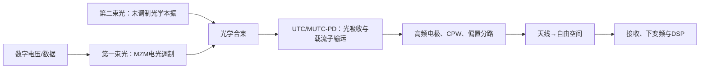

# 光子辅助亚太赫兹发射：三篇核心论文调研收官归档与接续说明

更新日期：2026-11-17  
所属专项：[陈佰乐课题组：太赫兹器件与系统集成](README.md)  
性质：**科研技术调研、讲解准备与知识资产整理**。不是论文综述投稿，也不是商业合作建议或已选定的博士课题。

## 1. 任务、研究对象与归档状态

围绕西湖大学刘癸庚老师关注的太赫兹器件/系统集成，分析陈佰乐团队及其合作者在**光子辅助亚太赫兹发射**方向的具体技术工作。从产业系统节点视角辨认可以集成的部件、物理限制与验证程度；重点关注“片上调制—高速光电拍频—紧凑射频输出/天线”的实现路径与接口，不替导师判断合作价值或商业化路线。

### 本次完成

- 已精读并对照三篇全文、核心原文图与系统实验，分别建立器件、RF输出和光学输入侧的物理问题空间；
- 已完成广义传输链的物理模型以及PIN→UTC→MUTC对比、波导光学模式匹配、异质结电场/RC、射频偏置隔离、悬浮天线、TFLN/InP双台阶耦合的解释；
- 已将首次汇报深度定在**物理过程清楚 + 每篇2—3项实际技术设计 + 原文验证 + 下一段问题**；细节推导保留于研究笔记；
- 已完成 **Work v3：9页主讲＋3页技术备份**，并逐页讲解演练及若干针对性答疑；
- 已从三篇原始PDF整理35张Figure/子图PNG、5张自绘SVG及PNG预览、9页讲述卡片；来源/裁切记录见素材包目录（图片未纳入GitHub仓库）；
- **本次GitHub提交内容为Markdown研究资产与索引；PPTX、PDF原稿、PNG/SVG等二进制文件仍为会话附件/工作目录素材，不应把文件链接写成“已上传GitHub”。**

### 版本与文件清单

| 类型 | 状态 | 主要入口 |
|---|---|---|
| 研究问题推演、证据与H1—H4 | 已归档 | [长篇问题推演框架](2026-11-16-problem-derivation-and-evidence-framework.md) |
| 第一、第二篇讲述稿 | 已归档 | [MUTC与硅中介层讲述稿](2026-11-16-oral-narrative-highspeed-pd-and-rf-antenna.md) |
| 第三篇讲述稿 | 已归档 | [TFLN/InP讲述稿](2026-11-16-oral-narrative-tfln-inp-integrated-transmitter.md) |
| 九页分页图源与最初演讲结构 | 已归档，属前期设计版本 | [9页大纲](2026-11-16-three-paper-presentation-outline.md) |
| 图片准备清单 | 已归档，高清图已裁切 | [素材与图号索引](2026-11-16-9page-material-asset-checklist.md) |
| **实际Work v3的九页/三备份结构、逐页讲法** | **本次补档** | [讲述与备份提纲](2026-11-17-v3-slide-notes-and-rehearsal.md) |
| **三篇原文关键数字、实验条件、图号与追问** | **本次补档** | [事实校验与问答](2026-11-17-source-evidence-and-technical-faq.md) |

## 2. 整场调研遵循的一条物理链

- **数据由光学调制写入；光频差设置高频载波**：$f_\mathrm{RF}=|f_1-f_2|$。170 GHz载频不等于170 GHz通信带宽，也不等于170 Gbit/s。
- 光经InGaAs吸收产生电子—空穴对，运动载流子通过感应电流与端口响应形成高频电信号；**不是单个电子每秒往返1700亿次**。
- 光在波导方向传播并持续与吸收层重叠；载流子主要沿外延层厚度方向收集。延长有源长度可提高吸收，也可能增大结电容。
- 电极电流激励RF电磁场，RF互连/偏置网络/天线及无线接收端共同决定端到端频率响应、输出功率、SNR、BER和数据率。

**讲述顺序**：先进入PD内部（第一篇），再沿输出端进入RF/天线（第二篇），最后回到PD输入侧的光学集成（第三篇）。这是**研究问题组织顺序**，而非同一器件迭代顺序。

## 3. 核心文献与技术认识

### 3.1 Li等，Nature Photonics (2025)：高速波导MUTC-PD

*Modified uni-travelling-carrier photodiodes with 206 GHz bandwidth and 0.81 A W−1 external responsivity.* DOI: https://doi.org/10.1038/s41566-025-01784-0

**问题**：光吸收效率提高通常导致吸收区长度/尺寸、载流子输运时间或电容上升；需兼顾外部响应度、带宽与较高光电流工作。

**具体工作**：
1. 两段式**光斑尺寸转换器**（Spot-Size Converter）：稀释波导解决光纤到波导耦合，InGaAsP层帮助模式逐渐进入InGaAs吸收区；光沿长向传播、载流子沿外延厚度收集；
2. 部分耗尽MUTC：165 nm InGaAs吸收层，100 nm耗尽/65 nm未耗尽；p型阶梯掺杂、异质结过渡层、n型InP cliff层调节电子输运、电场及高光电流空间电荷效应；
3. CPW下方低介电常数BCB，减少电极寄生电容与RC响应限制。

**主要证据**：7/10/15 μm器件的外部响应度为0.29/0.53/0.81 A/W，3 dB带宽为278/243/206 GHz（两类指标测量条件不同，应分别报告）；WR-5.1波导封装模块在8.5 mA下127—185 GHz输出高于−5 dBm；150 GHz、54 m、最高120 Gbit/s线路速率演示。Fig.1e的416 GHz是输运模型值，不是实测器件带宽。

**技术边界**：吸收长度与结电容的权衡并未消失；WR-5.1模块解决标准波导输出，但不是PD片上集成天线，也不代表已完成全片上收发系统。

### 3.2 Lu等，JLT (2025)：混合集成RF输出与悬浮天线

*Hybrid Silicon-Interposer Platform With Integrated Suspended Antenna for Compact Photonic Terahertz Communications.* DOI: https://doi.org/10.1109/JLT.2025.3600999

**问题**：PD产生的高频电流需要经过几何敏感的射频互连、直流偏置支路和受衬底影响的天线，才能进入自由空间。

**具体工作**：
1. 金凸点倒装焊把波导MUTC-PD接至高阻硅中介层CPW，调几何减轻失配，设计目标阻抗约50Ω；
2. CSRR型RF choke/偏置三通：直流反向偏压提供工作电场，170 GHz信号沿RF主通路前往天线，限制其向偏压源泄漏；
3. 去除天线下方部分Si，以约300 nm SiNₓ悬浮膜和金属反射结构调整辐射边界条件；工艺涉及应力与机械稳定性。

**主要证据**：162—194 GHz主路$S_{21}>-3$ dB、偏压端$S_{31}<-10$ dB均是**仿真**；天线7.22 dBi是**仿真实现增益**；实测在170 GHz、最高12 Gbaud OOK（12 Gbit/s）下进行无线通信，并报告均衡后的BER/眼图。

**技术边界**：片上集成PD＋RF互连＋偏置＋天线，光源、MZM、EDFA、接收机仍在片外。RF仿真、接收功率实测与BER演示属于不同证据层级。

### 3.3 Wang等，Nature Communications (2026)：TFLN/InP光学输入侧集成

*Heterogeneously integrated photonic terahertz transmitter on thin-film lithium niobate.* DOI: https://doi.org/10.1038/s41467-026-76733-8

**问题**：光学调制与光电转换材料功能不同，且TFLN波导导模与高折射率InGaAs吸收区之间存在跨材料光场耦合困难。

**具体工作**：
1. TFLN MZM电光调制、MMI合束、InP体系UTC-PD异质键合；单子载波调制指**只调制一束光**，另一束为光学本振，以降低多电平幅度调制的乘积非线性；
2. InP双台阶模式匹配，使光场从下方TFLN逐步转入上方InGaAs吸收区；7 μm有源区下模拟吸收量子效率双台阶56.46%、单台阶26.07%、无匹配20.34%；
3. 部分耗尽吸收区和cliff等电场/输运设计，与TFLN光学调制功能相互配合。

**主要证据**：2×7 μm² UTC-PD在1 mA测得240 GHz的3 dB带宽；内部响应度0.67 A/W、外部约0.21 A/W（光纤→TFLN输入约5 dB损耗）；TFLN MZM电光带宽>67 GHz；0.2 m下150 GHz/40 Gbit/s、200 GHz/32 Gbit/s无线演示。

**技术边界**：片上MZM＋MMI＋UTC-PD，片外两激光器、EDFA、探针接天线、接收机和DSP仍在；双台阶解决片内模式转移，未消除光纤入片损耗；器件带宽不等于有效数据率。

## 4. 讲述与成果的最终形态

**正式材料（用户在ChatGPT对话提交的Work v3）：** `光子辅助亚太赫兹发射_三篇论文调研_暖色精简版_v3.pptx`。结构为**9页主体＋3页技术备份**。主讲页依次为：完整信号链；PIN/UTC/MUTC；波导MUTC器件；硅中介层RF/悬浮天线；170 GHz OOK演示；TFLN/InP架构；双台阶模式匹配；UTC-PD与无线链路实测；三个接口与后续可检验问题。技术备份为：指标与实验条件；原文来源/合作贡献；光学吸收空间分布与饱和的研究假说。

**表达约束（已明确）**：无动画；中文使用等线（正文）；白色/克制配色、原文图清晰；不要大面积装饰背景或页脚防御性文字；用自然科研书面语，不靠“高大上”形容词堆砌结论；口头讲实际物理过程，备份用来答疑。最终采用的暖色精简版是用户带入的Work版本，并非此前两版自动生成PPT。

**附件清单与文件完整性（用户会话/本地，不代表仓库已收录二进制）**：
- Work v3 PPTX：`光子辅助亚太赫兹发射_三篇论文调研_暖色精简版_v3.pptx`，本次工作目录校验SHA-256：`da2ebf174d5eaad29d11eb85f7e59d233c63fdd67e96e740606d857bbfde0b5f`（2,854,150 bytes）。
- 原图素材包：`THz_9Page_Materials_2026-11-16_OriginalFigures_Complete.zip`，SHA-256：`32272f66e7f20bc123f483804b6ac37363b940db95c13087df7ba098303ff27f`，含原文图裁切元数据、SVG/PNG及逐页卡片。
- 三份原始PDF：用户已于会话提供；正式来源见上方三个DOI。仓库仅记录题录与图号，不主张版权受限PDF已上传。
- **后续若需长期迁移幻灯片与图片**：需用户或有文件上传权限的agent将上述二进制文件存入该专项的受控附件存储/合适的资产仓库，并核对SHA-256；文字文档已经可直接在GitHub继续使用。

## 5. 本次讲述中确认的特殊问题

- **UTC未耗尽吸收区为什么不直接施加强电场？** 反向偏压加在器件两端，内部电势降由掺杂、自由载流子屏蔽和空间电荷决定；耗尽区电场强，未耗尽p型区通常场较弱。简单增加两端电压并不能独立设定每段电场。MUTC用部分耗尽、掺杂梯度和异质结局部电场优化改善输运。
- **为什么MUTC吸收区不能全部耗尽？** 更厚耗尽层减少电子扩散时间，但会增加空穴漂移对高频电流响应的影响；存在折中，论文Fig.1e模拟得到100 nm附近更好。感应电流在载流子运动时即产生，不需等到所有载流子到达电极。
- **波导长度与吸收厚度为什么不同？** 延长光吸收的纵向作用路径不同比例增加载流子在厚度方向的收集距离；但会增大有源结面积/电容，故无法无限加长。
- **第一篇用了什么天线？** 主文明确的是WR-5.1矩形波导输出模块、石英被动电路、CPW→探针→TE10模式转接；**并未在主文指明54 m无线实验所用外部天线的确切型号/增益**。不能把WR-5.1叫做“片上天线”。
- **第二篇传输距离？** 论文在接收功率表征装置中将喇叭天线置于器件上方“数厘米”；无线通信部分沿用相同接收架构，但**没有明确报告严格的具体传输距离**。引用为“厘米量级演示/具体距离未报告”，不自造数字。
- **第三篇传输距离？** 明确为0.2 m（20 cm）；150 GHz最高40 Gbit/s、200 GHz最高32 Gbit/s。
- **信号口径**：天线实现增益7.22 dBi是仿真，416 GHz是载流子输运模型，56.46%是FDTD模拟；206/240 GHz是器件实测带宽；12/40/32/120 Gbit/s是各自条件下的原始线路速率。FEC门限比较并非已经做了实际纠错与吞吐率计量。

## 6. 下一阶段的研究路线（并未实施）

按已有问题推演框架持续保留H1—H4，首次汇报只挑两项：

1. **H1：170 GHz附近输入侧TFLN/InP与RF/天线输出协同设计**；控制光功率、偏压、光电流和数据格式，比较馈电损耗、辐射功率/EIRP、频响与BER。必须处理基底与键合/互连可制造性，不假设两项已有器件可以直接拼接。
2. **H2：降低光纤→TFLN入片约5 dB耦合损耗**；候选为渐变模式扩展/边缘耦合及封装，测外部响应度、偏振/对准容差、温漂等。
3. **H3：联合设计光吸收分布与MUTC内部电场**；保持总吸收和平均电流近似相同，验证是否影响局部电场屏蔽及高功率射频压缩。该路径还缺乏直接实验证据，必须作为待证伪假说。
4. **H4：双光源相位噪声/频率稳定性和片上化**；与系统复杂度、能耗及链路可靠性共同研究，保留作远期分支。

这些是**问题清单而非已经采用的科研计划**。

## 7. 接续时最短阅读路径

**首先阅读本归档 → Work v3逐页讲述与答疑 → 三篇原文证据FAQ**；需要推导时再进入长篇问题框架，需要复用原先口头措辞时再看三篇讲述稿。不要重新从广域扫描开始；正式题录仍由仓库原有 `literature/index.csv` 维护，不另建总文献库。

## 8. 原始论文与出处

1. Li et al., *Nature Photonics* 19, 1301–1308 (2025), DOI: 10.1038/s41566-025-01784-0。
2. Lu et al., *Journal of Lightwave Technology* 43(19), 9368–9374 (2025), DOI: 10.1109/JLT.2025.3600999。
3. Wang et al., *Nature Communications* 17, 9797 (2026), DOI: 10.1038/s41467-026-76733-8。
